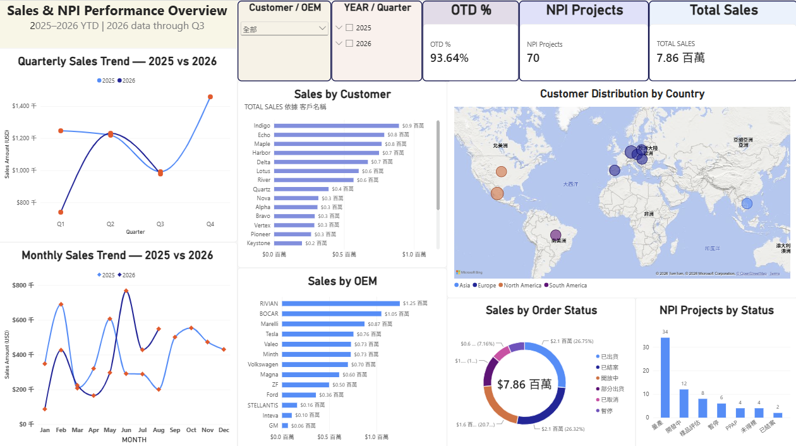

# Sales & NPI Performance Overview

**Power BI Portfolio Project | 2025–2026 YTD**

## Project Overview

This dashboard demonstrates how sales performance and New Product Introduction (NPI) project data can be organized into an interactive performance overview.

The project uses fictional sample data for portfolio demonstration and showcases KPI monitoring, sales trend analysis, order tracking, and NPI project status monitoring.

## Project Objective

The objective of this project is to improve visibility into sales performance, delivery status, and NPI project progress through an interactive Power BI dashboard.

By consolidating key performance indicators and project status information, this dashboard demonstrates how data visualization can support project monitoring, identify potential delivery risks, and facilitate data-driven decision-making.

## Key Metrics

- **Total Sales:** Overall sales performance
- **NPI Projects:** New product introduction project tracking
- **On-Time Delivery (OTD):** Delivery performance monitoring

## Dashboard Features

- **Sales Trend Analysis:** Monthly and quarterly sales comparisons between 2025 and 2026 YTD
- **Sales by Customer and OEM:** Analysis of sales distribution across customers and OEMs
- **Customer Distribution:** Geographic overview of customers by country
- **Order Status Monitoring:** Overview of order progress and status
- **NPI Project Tracking:** Monitoring of NPI project status
- **Interactive Filters:** Dynamic filtering by customer, OEM, year, and quarter

## Tools

- Microsoft Power BI Desktop

## Skills Demonstrated

- KPI Monitoring
- Sales Performance Analysis
- NPI Project Tracking
- Data Visualization
- Interactive Dashboard Design

## Dashboard Preview

## Notes

- All data is fictional and intended for portfolio demonstration only.
- 2026 data covers Q1–Q3 and should be interpreted as year-to-date data rather than a full-year comparison.
